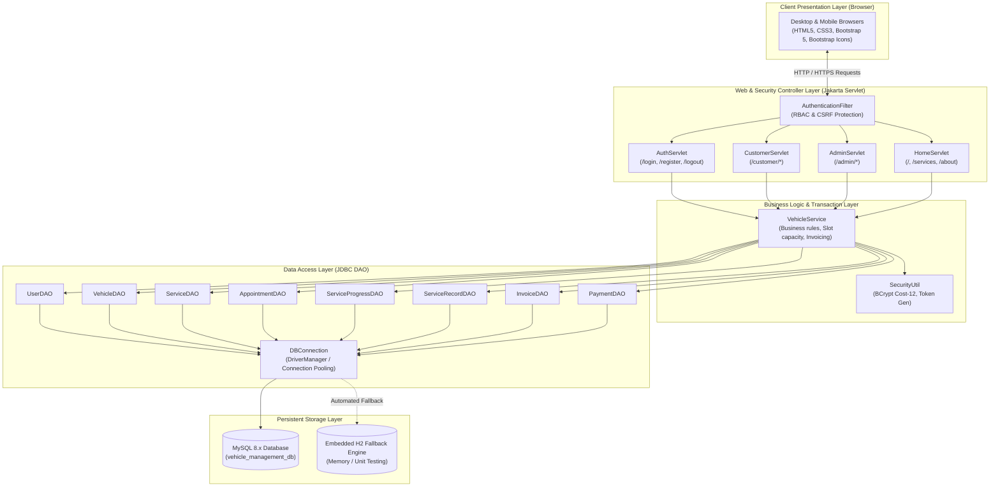
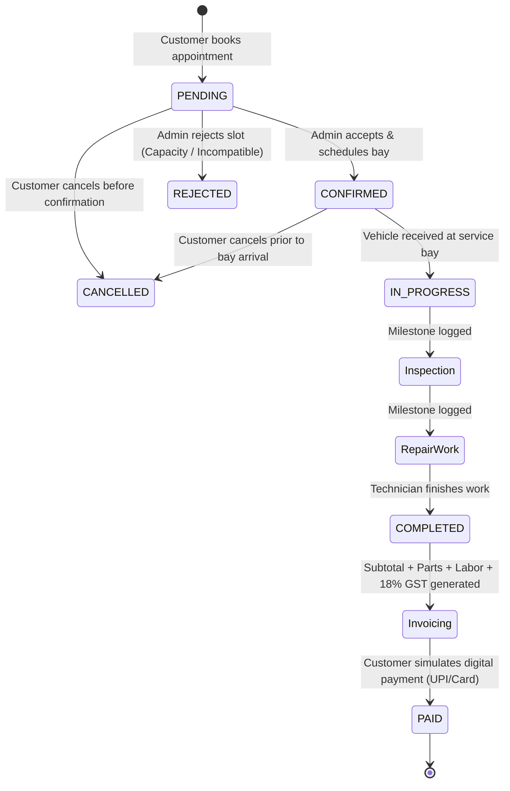

# System Architecture & Design

### 1. High-Level MVC Architecture
The system demonstrates strict separation of concerns using the classic 3-Tier Model-View-Controller (MVC) architecture:

---

### 2. Appointment Booking & Service Lifecycle Workflow

