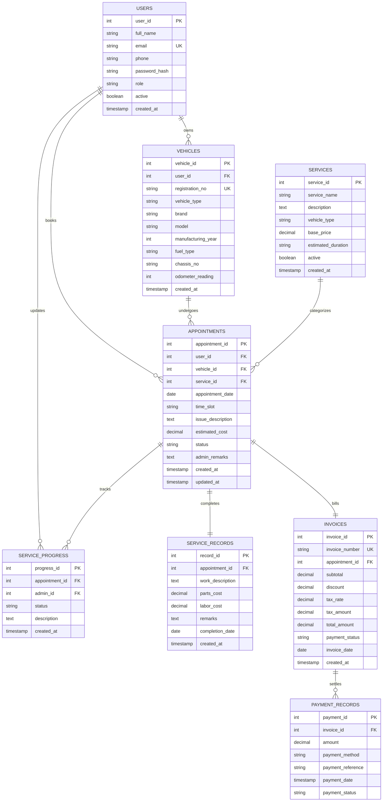

# Database Design & Entity Relationship (ER) Diagram

### Database Specifications
- **Database Engine:** MySQL 8.x InnoDB
- **Character Set:** `utf8mb4`
- **Collation:** `utf8mb4_unicode_ci`

---

### Entity Relationship (ER) Diagram

---

### Primary & Foreign Key Constraints Explained
1. **`users` (`user_id` PK)**: Stores unique accounts with unique email constraint (`UNIQUE(email)`).
2. **`vehicles` (`vehicle_id` PK, `user_id` FK)**: References `users(user_id)`. The `registration_no` is strictly unique (`UNIQUE(registration_no)`).
3. **`services` (`service_id` PK)**: Catalog of active and legacy services.
4. **`appointments` (`appointment_id` PK, `user_id` FK, `vehicle_id` FK, `service_id` FK)**: Connects customer, vehicle, and service package. Enforces a compound unique check (`UNIQUE(vehicle_id, appointment_date, time_slot)`) to prevent duplicate bookings for the same vehicle.
5. **`service_progress` (`progress_id` PK, `appointment_id` FK, `admin_id` FK)**: Chronological milestone tracker referencing `appointments` and the updating administrator.
6. **`service_records` (`record_id` PK, `appointment_id` FK UNIQUE)**: Stores permanent work descriptions and parts/labor logs.
7. **`invoices` (`invoice_id` PK, `invoice_number` UK, `appointment_id` FK UNIQUE)**: Guarantees exactly one final tax invoice per completed service.
8. **`payment_records` (`payment_id` PK, `invoice_id` FK)**: Audit trail of simulated payments against invoices.
